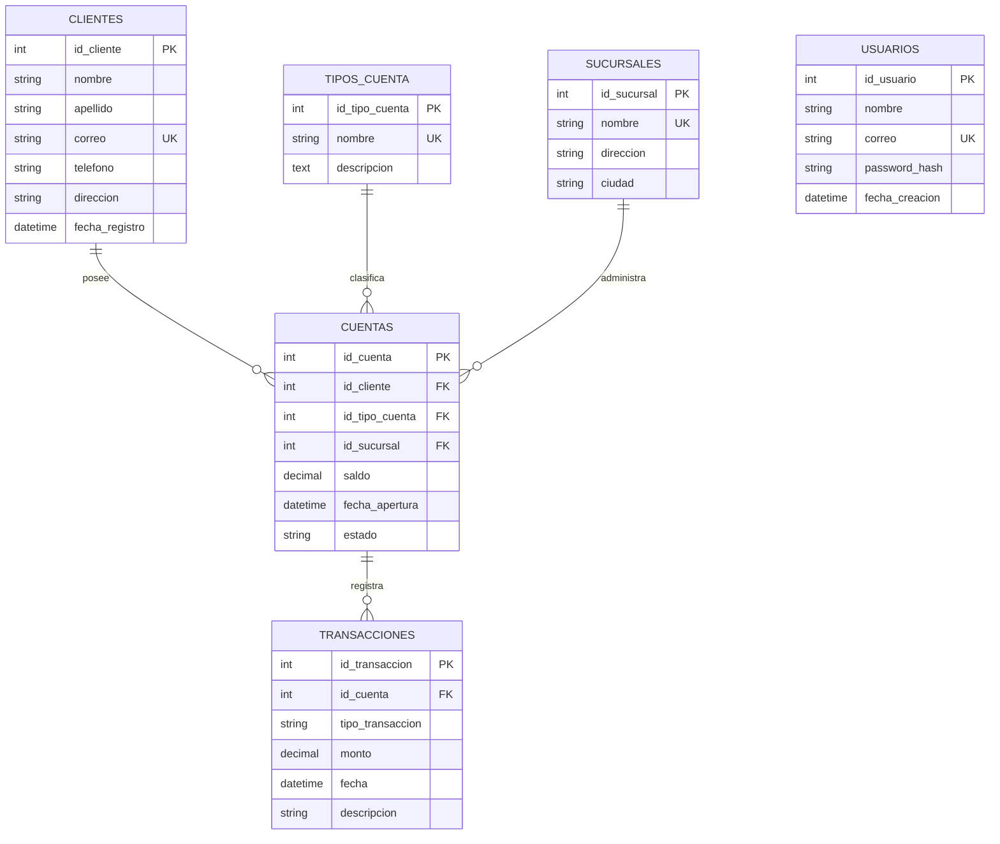

# Diagrama entidad-relación

El modelo mantiene `Usuario` independiente del dominio bancario. Las relaciones de las cuentas con clientes, tipos y sucursales son de muchos a uno; cada cuenta puede tener varias transacciones.

`usuarios.password` se almacena como hash bcrypt; el nombre `password_hash` del diagrama expresa que el valor persistido no es texto plano.
